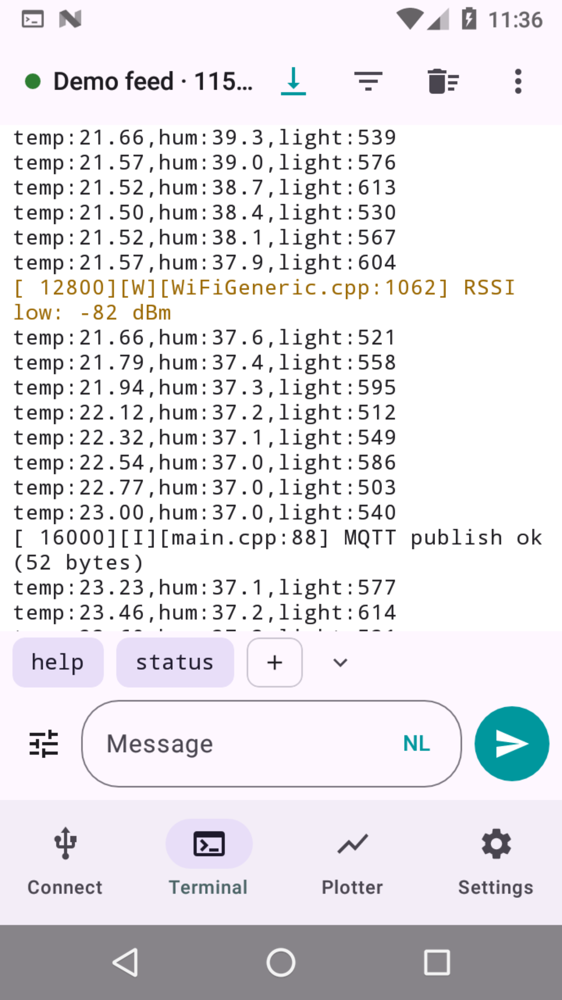
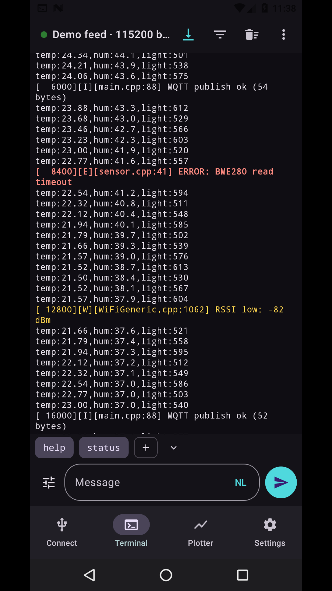
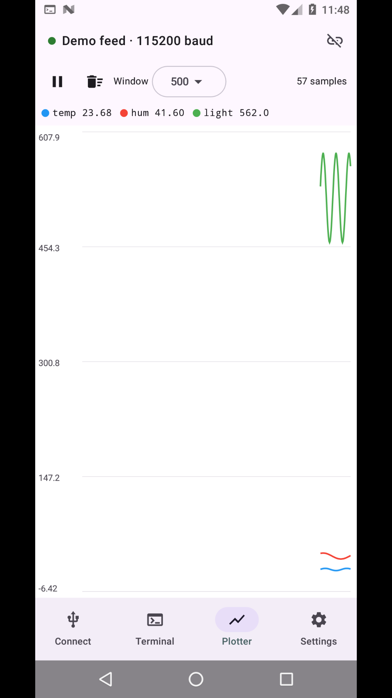

# Serial Monitor

A serial monitor for Arduino and ESP32 boards, built to replace (and outdo) the Arduino IDE's Serial Monitor. There's a **Windows desktop app** and an **Android app**.

  
  
  

## Desktop (Windows) — [`desktop/`](desktop)

Python + tkinter + pyserial, packaged as a single `SerialMonitor.exe`.

- Port picker with auto-refresh, Arduino's full baud list, line-ending options, command history
- Autoscroll, timestamps, clear, save log, auto-reconnect when a board is unplugged and plugged back in
- Live plotter (Arduino Serial Plotter format, including `label:value`), hex/raw view, mini dashboard readouts
- Macro buttons, highlight and filter rules, find in output, alerts with sound/popup
- CSV logging, session replay, send file, repeat-send timer
- Multiple boards at once in tabs, auto-detect baud rate
- Board tools: reset button, DTR/RTS toggles, port info (VID:PID, serial number, etc.)
- Checksum/CRC calculator, ESP32/ESP8266 crash backtrace decoder
- Dark mode, settings remembered between sessions

**Build:** install Python 3, then run `build.bat` in `desktop/`. The exe lands in `desktop\dist\SerialMonitor.exe`.
Or run from source: `pip install pyserial` then `python serial_monitor.py`.

## Android — [`android/`](android)

Native Kotlin + Jetpack Compose (Material 3), minSdk 24 (Android 7.0+).

- **USB OTG:** CH340/CH341, CH9102/CH343, CP210x, FTDI, PL2303, CDC-ACM, and ESP32-S2/S3/C3/C6/H2 native USB
- **Bluetooth Classic (SPP):** HC-05/HC-06, original ESP32 `BluetoothSerial`
- **BLE UART:** Nordic UART Service (ESP32 BLE examples, NimBLE), HM-10/HC-08 (FFE0/FFE1), or pick any characteristic
- Arduino and ESP32 (esptool-style) reset sequences that never leave an ESP in download mode
- Terminal with timestamps, hex view, filter, ERROR/WARN highlighting, ESP crash-dump detection and copy
- Macros, hex send, CRC append, command history, live plotter, log save/share, CSV logging
- Foreground service keeps the connection alive in the background and through rotation; auto-reconnect

**Build:** `cd android && ./gradlew assembleDebug` (JDK 17 + Android SDK required).

## Install

Prebuilt `SerialMonitor.exe` and `SerialMonitor.apk` are attached to the [latest release](../../releases/latest).
On Android, allow "Install unknown apps" for whichever app opens the APK, and use a USB OTG adapter for wired boards.

## Tips

- Close the Arduino IDE's Serial Monitor first: Windows lets only one program open a COM port at a time ("Access is denied" means something else has it).
- ESP32 boards usually talk at 115200 baud; classic Arduino sketches often use 9600.
